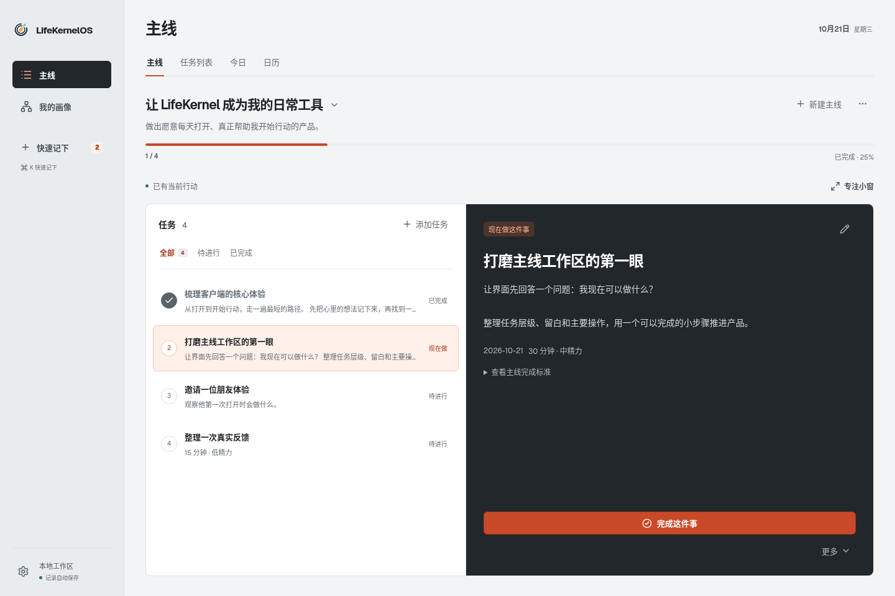
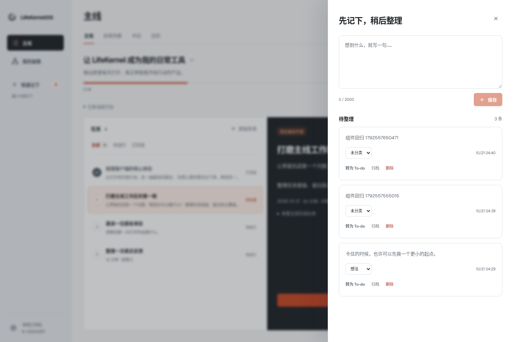
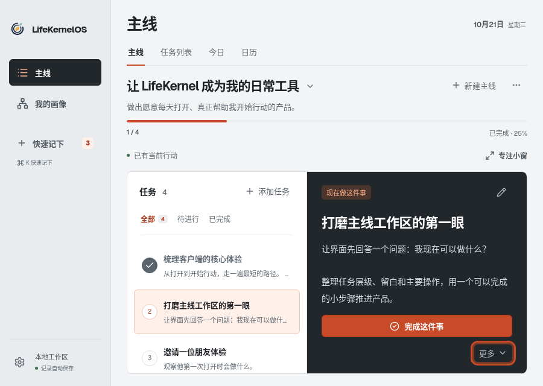

# 前端基础组件统一记录

日期：2026-10-21。决策见 [ADR-0014](../architecture/decisions/0014-shared-frontend-components.md)，产品范围仍为 [SPEC-0015](../specs/current/0015-minimal-action-interface.md) 的既有日常界面。

## 已实现

- Button、Input、Textarea 采用与 ClipJar 同源的 [shadcn/ui Radix 基础组件](https://github.com/shadcn-ui/ui/tree/ba1503c64472b82256d9de95e2e62c5901a38e8b/apps/v4/registry/bases/radix/ui) 与该版本的 Nova 样式段。`components.json` 记录 `radix-nova`。
- 现有业务按钮与文本输入复用 `apps/web/src/components/ui/`；显式选择按钮变体，保留业务布局、朱橙 `#c94a28` 和当前行动的深色面板。
- 图标迁至 Lucide；Geist 字体自托管，中文回退系统字体。MIT / OFL 文件随 `public/licenses/` 分发。
- 更多菜单入场使用 Motion；保留原菜单的方向键、Tab、Escape、禁用和焦点契约，减少动态效果时不做位移入场。
- Zustand 只管理收集箱开关；业务数据、草稿和校验继续由原有 API / 业务进程负责。

原生 select、CaptureDrawer / AiTaskDialog 的既有控制器和图谱没有改成另一套实现。不要据此宣称所有业务组件已经迁移。

## 验证与复现

```bash
npm ci
npm run docs:check
npm test
npm run build
node --test scripts/desktop-packaging.test.mjs
npx playwright install chromium
npm run test:ui
```

`test:ui` 默认启动独立示例 SQLite 工作区，结束后清理；覆盖表单绑定、空值禁用、保存、Escape / 焦点返回及 900×640 菜单键盘操作。可用 `PLAYWRIGHT_EXECUTABLE_PATH` 指定现有 Chromium。生成截图时设置 `UI_SCREENSHOT_DIR`；`UI_BASE_URL` 只应指向独立的测试预览。

本轮：108 项既有测试、7 项打包门禁、2 项浏览器场景及构建通过。云环境的本地 Electron smoke 因 `chrome-sandbox` 未配置所需属主和权限而无法启动；这不计作桌面验收通过，原生验证以 GitHub Desktop CI 和实机记录为准。Spec 继续为 Implemented。

## 实际截图

使用独立示例数据，非用户工作区。







[跨项目约定](https://github.com/KeatonLi/clipjar/blob/main/docs/shared-frontend-standard.md)
